# Manual de Usuario — OxigenScript

- **Curso:** Organización de Lenguajes y Compiladores 2
- **Universidad:** Universidad de San Carlos de Guatemala
- **Estudiante:** Mayelin Lucía Quevedo Camey carnet:202307771


---

## 1. Introducción

OxigenScript es un intérprete web para un lenguaje académico con sintaxis inspirada en Rust. Esta herramienta permite escribir, ejecutar y depurar programas escritos en OxigenScript directamente desde el navegador, mostrando la salida de la ejecución junto con reportes de análisis léxico, errores, tabla de símbolos y el árbol de sintaxis abstracta (AST) del programa.

Este manual explica, paso a paso, cómo instalar y ejecutar la herramienta, y cómo usar cada una de sus funciones.

---

## 2. Requisitos previos

Antes de instalar la herramienta, debes tener instalado en tu computadora:

- **Python 3.10 o superior**
- **Node.js 18 o superior** (incluye npm)
- **Git**
- **Graphviz** (paquete de sistema, necesario para el reporte del AST)

---

## 3. Instalación

### 3.1. Clonar el repositorio

```bash
git clone https://github.com/mayelinquevedo/OLC2_B_P1_2S2026.git
cd OLC2_B_P1_2S2026
```

### 3.2. Configurar el backend

```bash
cd backend
python3 -m venv venv
source venv/bin/activate       # En Linux/Mac
pip install -r requirements.txt
```

### 3.3. Instalar Graphviz (paquete de sistema)

En Linux (Debian/Ubuntu/Mint):
```bash
sudo apt install graphviz
```

### 3.4. Configurar el frontend

En una terminal aparte, desde la raíz del proyecto:
```bash
cd frontend
npm install
```

---

## 4. Ejecución de la herramienta

La aplicación requiere que **dos servidores estén corriendo al mismo tiempo**: el backend (Flask) y el frontend (React). Se recomienda usar dos terminales distintas.

### 4.1. Iniciar el backend

En la primera terminal, dentro de la carpeta `backend/` (con el entorno virtual activado):

```bash
python3 app.py
```

Deberías ver un mensaje similar a:
```
* Running on http://127.0.0.1:8000
```

Deja esta terminal abierta mientras uses la aplicación.

### 4.2. Iniciar el frontend

En la segunda terminal, dentro de la carpeta `frontend/`:

```bash
npm start
```

Esto abrirá automáticamente tu navegador en `http://localhost:3000`, mostrando la interfaz de OxigenScript.


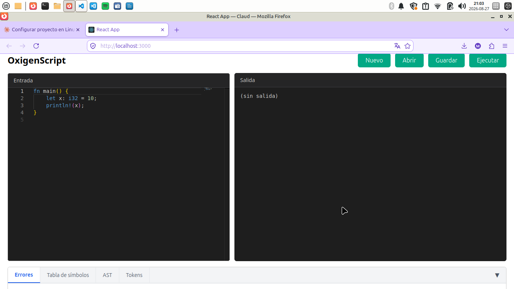
---

## 5. Descripción de la interfaz

La interfaz se divide en las siguientes zonas:

1. **Barra de herramientas** (parte superior): contiene los botones Nuevo, Abrir, Guardar y Ejecutar.
 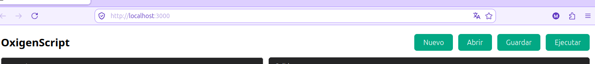 
2. **Editor de código** (columna izquierda): donde se escribe el programa en OxigenScript.
 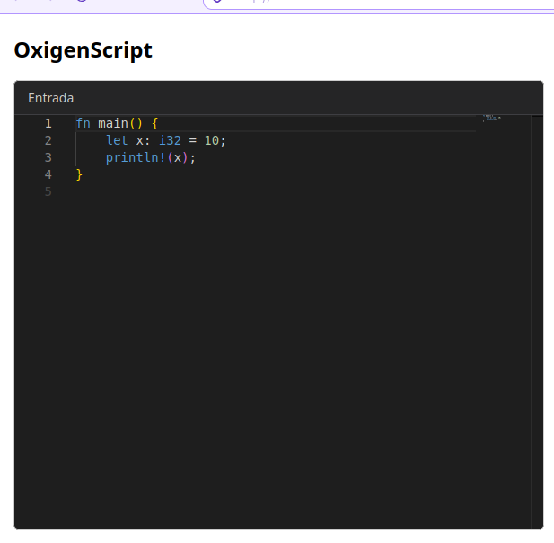
3. **Consola de salida** (columna derecha): muestra el resultado de la ejecución.
    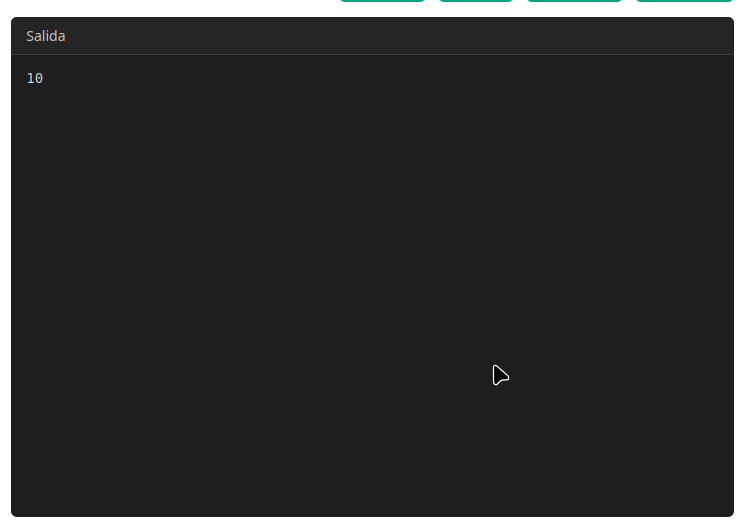
4. **Panel de reportes** (parte inferior): organizado en pestañas (Errores, Tabla de símbolos, AST, Tokens).
   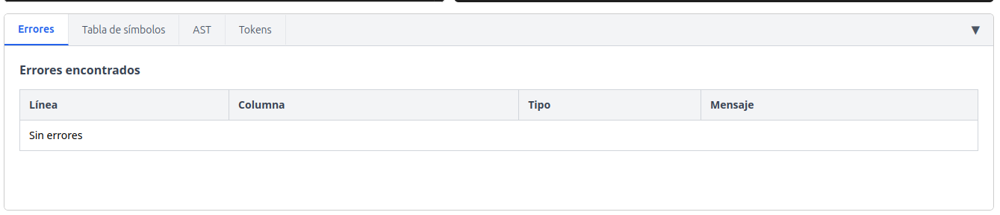

---

## 6. Uso de la barra de herramientas

### 6.1. Botón "Nuevo"

Limpia el editor y todos los reportes, permitiendo empezar un programa desde cero.

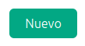

### 6.2. Botón "Abrir"

Permite cargar un archivo de código OxigenScript (`.txt`, `.oxigen`, u otro archivo de texto) desde tu computadora hacia el editor.

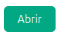

**Pasos:**
1. Haz clic en el botón "Abrir".
2. Selecciona el archivo desde el explorador de tu sistema operativo.
3. El contenido del archivo se cargará automáticamente en el editor.

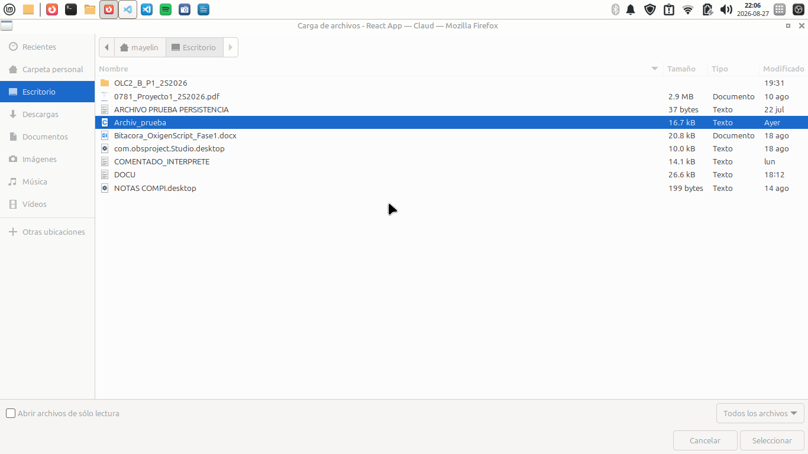

### 6.3. Botón "Guardar"

Guarda el contenido actual del editor como un archivo de texto en tu computadora.
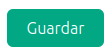

**Pasos:**
1. Escribe o edita tu código en el editor.
2. Haz clic en el botón "Guardar".
3. Según tu navegador,  se descargará automáticamente como `archivo.txt`.

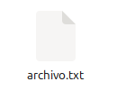

### 6.4. Botón "Ejecutar"

Envía el código del editor al intérprete y muestra los resultados. Mientras el programa se está ejecutando, el botón cambia su texto a "Ejecutando..." y se deshabilita temporalmente.
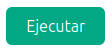

---

## 7. Escribir y ejecutar un programa

### 7.1. Ejemplo básico

Escribe el siguiente código en el editor:

```rust
fn main() {
    let x: i32 = 10;
    println!("{}", x);
}
```

Haz clic en "Ejecutar". En la consola de salida debería aparecer:

```
10
```

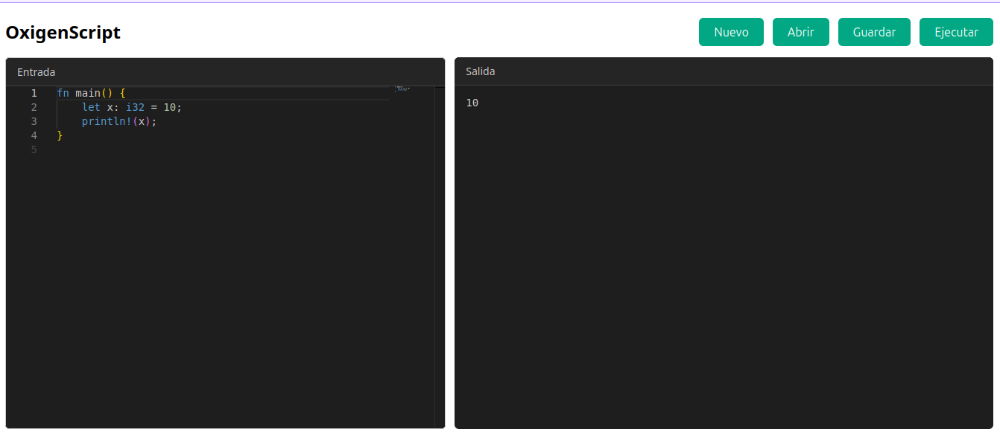


### 7.2. Ejemplo con control de flujo

```rust
fn main() {
    let mut contador: i32 = 0;
    let numeros = [10, 20, 30];

    while contador < 3 {
        println!("{}", numeros[contador]);
        contador += 1;
    }

    if contador == 3 {
        println!("Listo!");
    }
}
```

Este ejemplo demuestra el uso de variables mutables, arreglos, ciclos `while` y condicionales `if`.

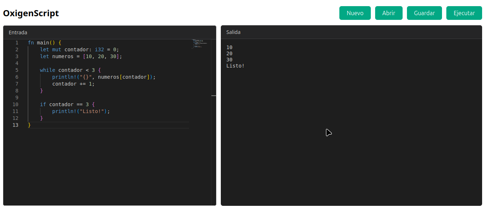
---

## 8. Panel de reportes

Debajo del editor y la consola se encuentra el panel de reportes, organizado en 4 pestañas. El panel puede contraerse o expandirse con el botón ▼/▲ ubicado a la derecha de las pestañas.


### 8.1. Pestaña "Errores"

Muestra una tabla con todos los errores léxicos, sintácticos y semánticos detectados en el programa, indicando línea, columna, tipo de error y una descripción del problema. Si no hay errores, se muestra el mensaje "Sin errores".

**Ejemplo de código con errores, para probar esta pestaña:**

```rust
fn main() {
    let x: i32 = 10;
    println!("{}", y);
}
```

Como la variable `y` nunca fue declarada, este código genera un error semántico.

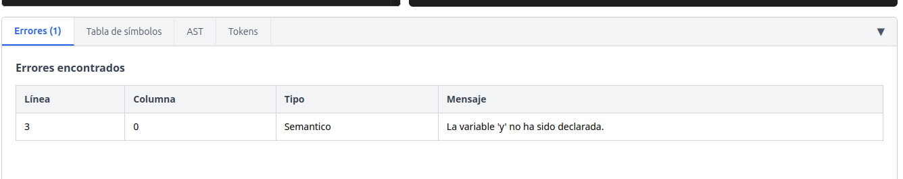

### 8.2. Pestaña "Tabla de símbolos"

Muestra todas las variables, funciones y structs detectados en el programa, junto con su categoría, tipo, ámbito (scope) y valor.

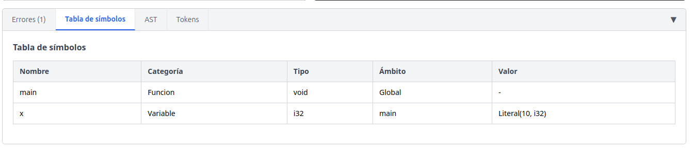

### 8.3. Pestaña "AST"

Muestra una representación gráfica del árbol de sintaxis abstracta (AST) del programa ejecutado, generada automáticamente mediante Graphviz. Cada nodo del árbol representa una construcción del lenguaje (declaraciones, operaciones, condicionales, etc.), y las flechas indican la relación entre un nodo y sus componentes.

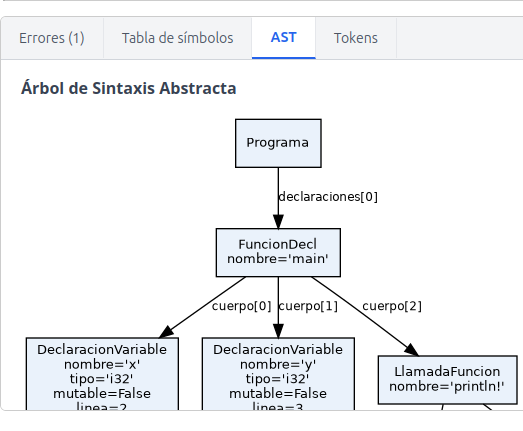


### 8.4. Pestaña "Tokens"

Muestra la lista completa de tokens reconocidos por el analizador léxico al procesar el código, indicando el lexema (texto original), el tipo de token y la línea donde aparece.

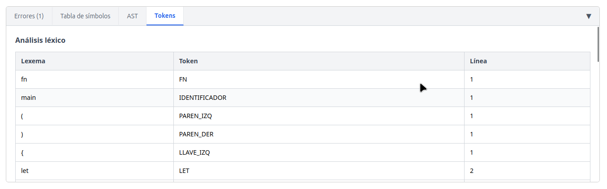


---

## 9. Manejo de errores

OxigenScript está diseñado para ser resiliente ante errores: en la medida de lo posible, el intérprete reporta todos los errores que encuentra en el código (en lugar de detenerse en el primero) y continúa analizando el resto del programa.

### 9.1. Ejemplo con múltiples errores

```rust
fn main() {
    let x: i32 = 10;
    let y@: i32 = 20;
    println!("{}", x);
}
```

Este código contiene un carácter inválido (`@`). El analizador léxico lo reportará como error, pero el resto del programa (incluyendo el `println!` final) seguirá ejecutándose con normalidad.
- 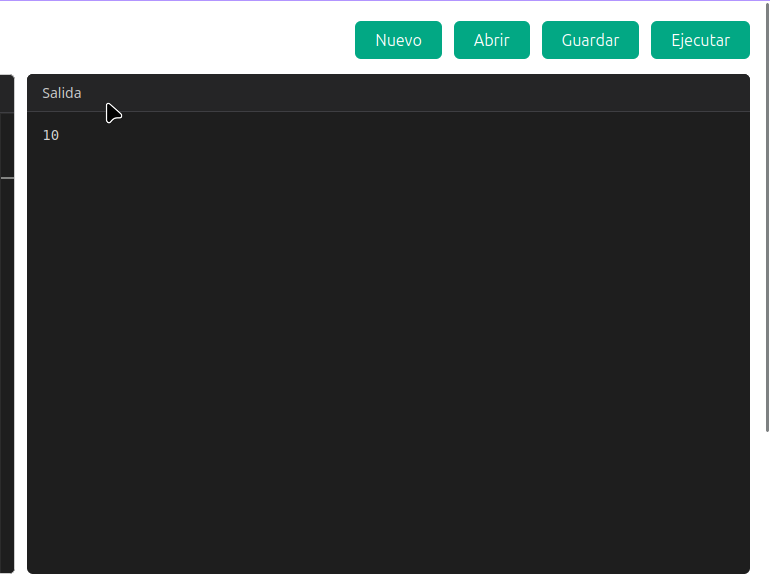
- 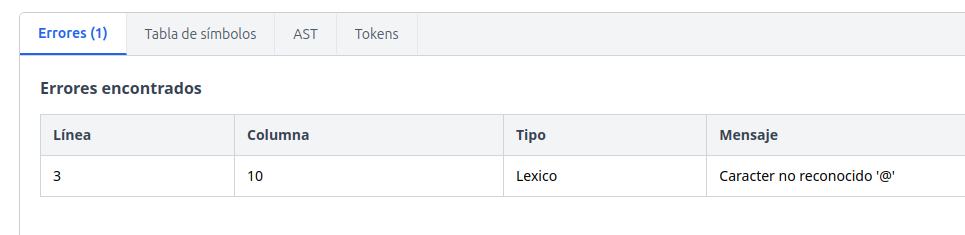


---
